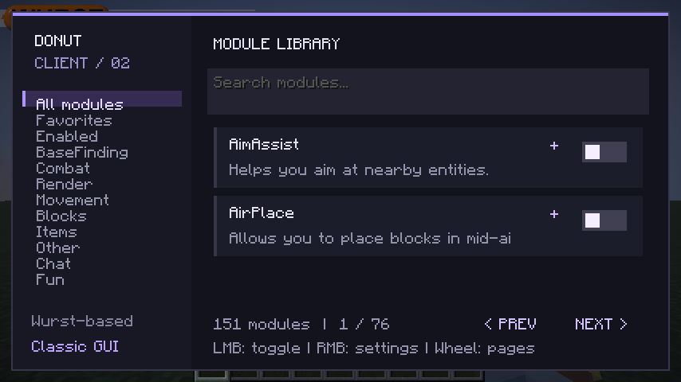

# Donut Client — Fabric 1.21.11

A Wurst-based client with a custom Donut dashboard, searchable categorized modules, favorites, persistent settings, keybinds, ESP, Freecam, Fullbright and combat/movement tools.

**[Download Donut Client 2.0.0 (.jar)](https://github.com/ItzNotMe-Creator/Donutsmphacktest/raw/refs/heads/main/downloads/Donut-Client-2.0.0.jar)** · [Full corresponding source (.jar)](https://github.com/ItzNotMe-Creator/Donutsmphacktest/raw/refs/heads/main/downloads/Donut-Client-2.0.0-sources.jar)

Install Fabric Loader **0.20.1+**, **Fabric API for Minecraft 1.21.11**, and Java 21. Remove the old Donut Lab JAR and any separate Wurst JAR, then put the new JAR in your `mods` folder.

**Right Shift** opens the new dashboard. **Right Control** opens the classic category windows. Left-click modules to toggle them, right-click for settings and keybinds, and use the star controls for favorites.

See [installation, features, controls, source credits and build instructions](client/README.md).

Build and a graphical local-world smoke test passed. See [the precise validation scope](client/TESTING.md). DonutSMP behavior is unverified.

This is a customized open-source Wurst build, not Krypton or an official DonutSMP client. No claim of DonutSMP anticheat bypasses is made. Base finding and ESP use information received by the client.

## Source and license

The new client lives in `client/` and is based on Wurst-Imperium/Wurst7's official 1.21.11 branch, under [GPL-3.0-or-later](client/LICENSE.txt). Original module implementations and copyright notices are retained. See [the upstream revision](client/UPSTREAM_COMMIT) and the modification summary in [client/README.md](client/README.md).

The original small Donut Lab toolkit remains at the repository root for reference. Its documentation is in [LEGACY-TOOLKIT.md](LEGACY-TOOLKIT.md); it is not the new client.
